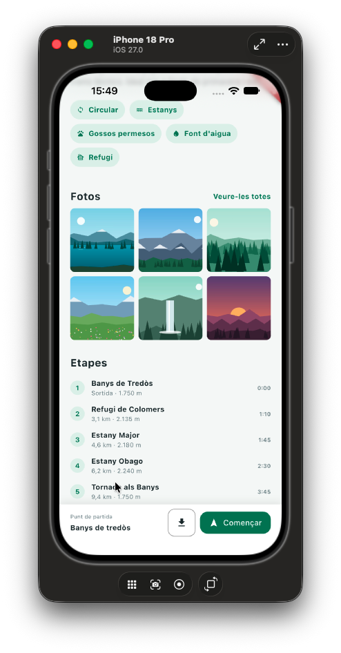
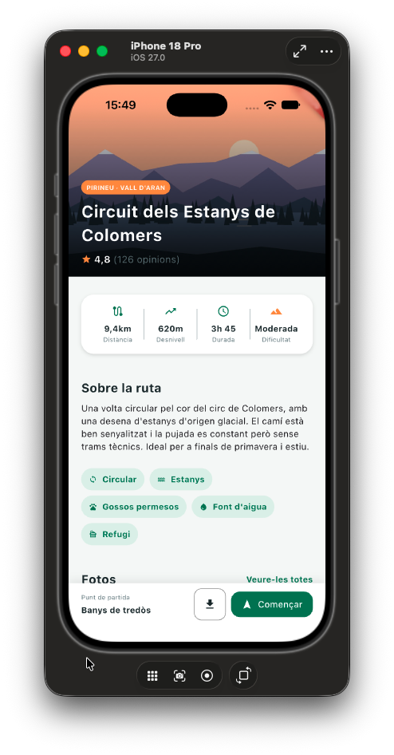
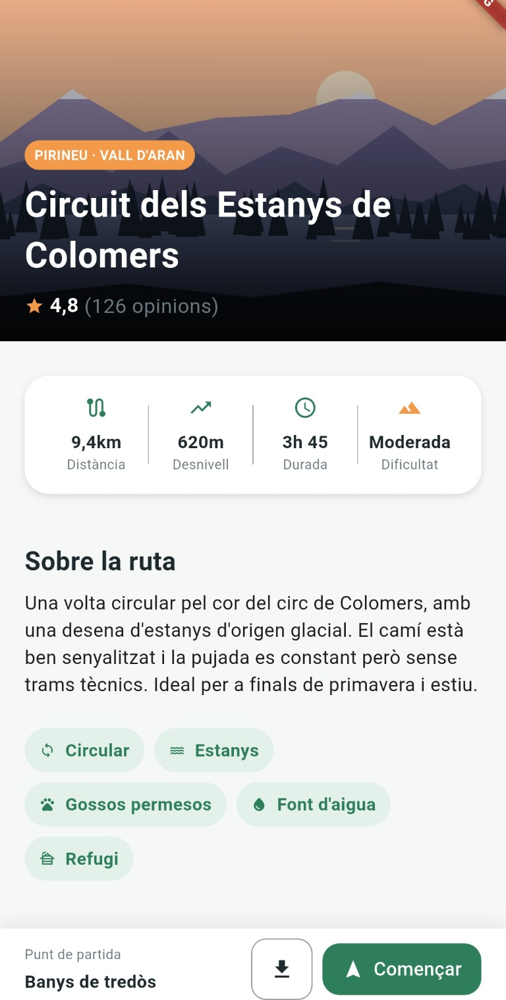
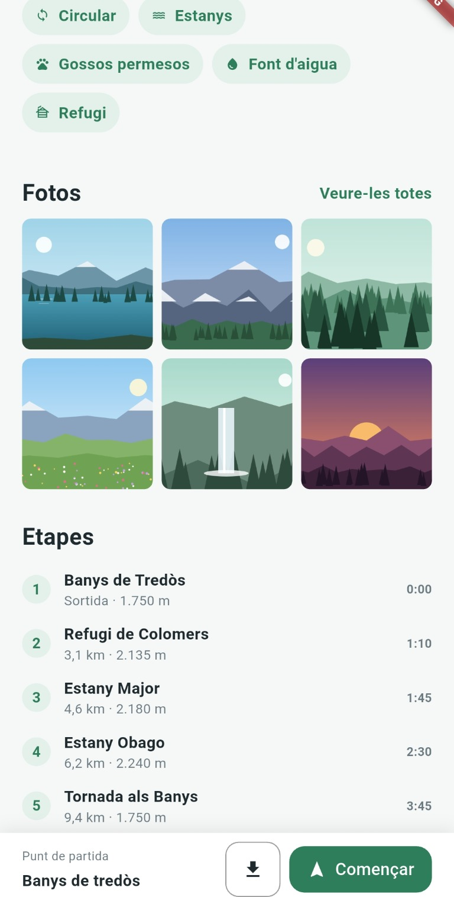
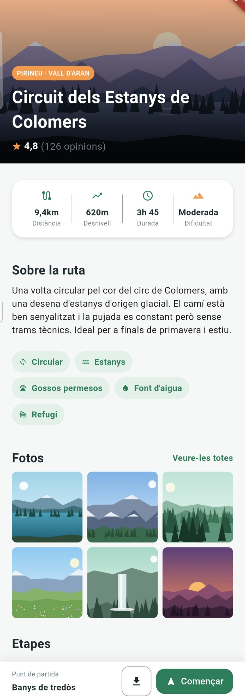

# Camins

Activitat 1.3 "De disseny a pantalla". Pantalla estàtica de detall d'una ruta de muntanya (Circuit dels Estanys de Colomers) feta amb Flutter a partir d'un disseny.

## Nivell fet

Nivell Base i ampliació:

- Capçalera amb imatge, regió, títol i valoració.
- Targeta amb les dades de la ruta (distància, desnivell, durada i dificultat).
- Secció "Sobre la ruta" amb text i etiquetes.
- Barra inferior fixa amb el punt de sortida, botó de descàrrega i botó "Començar".

- Graella de fotos de la ruta.
- Llista d'etapes de la ruta.

No s'ha fet el repte.

## Estructura

- `lib/main.dart`: punt d'entrada.
- `lib/screens/`: pantalla `TrailDetailScreen`.
- `lib/widgets/`: widgets reutilitzables (`TagChip`, `DataCard`, `StageRow`).
- `lib/styles/`: colors i espaiats a `AppStyles`.
- `assets/images/`: imatges de l'app.
- `assets/screenshots/`: captures de pantalla de l'exercici.

## Captures de pantalla

La pantalla s'ha comprovat al simulador d'iPhone i en un dispositiu Android físic.

### Simulador d'iPhone 18 Pro

  
  

### Dispositiu Android

  
  
  

## Reflexió

### Organització del codi

- Descomposició del disseny en widgets reutilitzables (`TagChip`, `DataCard`, `StageRow`) en lloc de construir una sola pantalla massiva.
- Separació per responsabilitats: pantalla a `lib/screens/`, components a `lib/widgets/` i estils centralitzats a `AppStyles`, cosa que facilita canviar colors i espaiats sense tocar la UI.

### Layout i espaiat

- La separació vertical entre elements, que és el que més em va costar, la vaig resoldre amb un `Container` amb l'alçada i el padding necessaris.
- Detecció i correcció de paddings incorrectes: el Flutter Inspector va ser clau per veure l'arbre de widgets i les mides reals de cada element.

### Barra inferior fixa (navbar bottom)

És la part on hi ha hagut més diferències entre dispositius. La causa és que cada dispositiu té àrees segures diferents (indicador de l'iPhone, barra de navegació d'Android):

- **iPhone (simulador):** la barra em quedava massa gran i separada de la vora inferior. Es amb el que vaig estar muntant.
- **Android (dispositiu físic):** la barra queda pegada a baix de tot, just sobre el menú de navegació del sistema.
